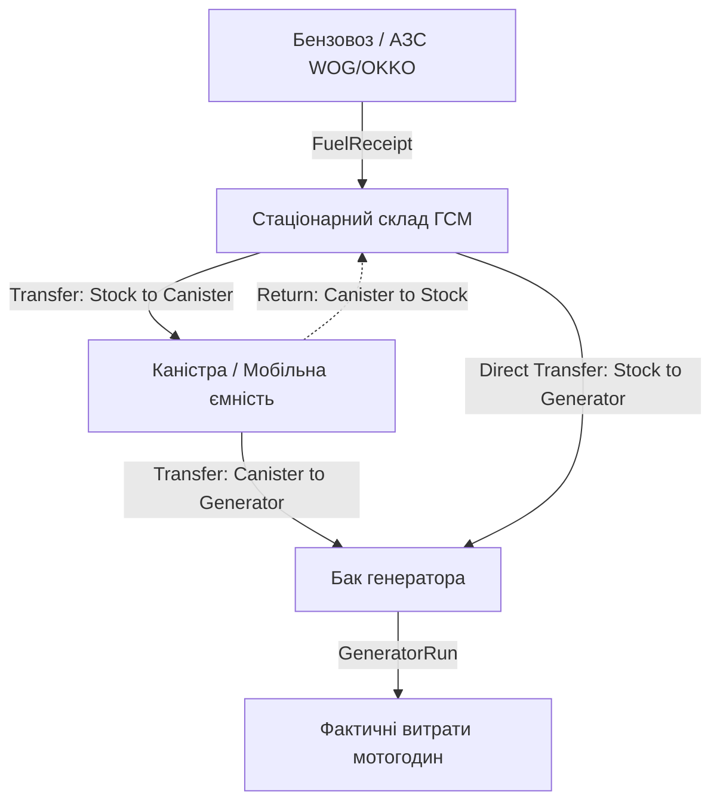

# Архітектурна специфікація обліку каністр та проміжних ємностей (FUEL-10)

**Проєкт:** SD-GEN016  
**Модуль:** Облік пального (Fuel Management Subsystem)  
**Статус:** Архітектурний дизайн (Proposed / Ready for Implementation)  
**Версія:** 1.0.0  

---

## 1. Контекст та бізнес-потреба

В умовах тривалої автономної експлуатації генераторів заправка баків рідко відбувається безпосередньо зі стаціонарного резервуара складу ГСМ за допомогою роздавального пістолета чи насоса. У більшості випадків використовується проміжний буферний транспорт — **каністри** (ємності 10л, 20л, 50л) або мобільні паливозаправники.

### Поточний ланцюг руху пального (до запровадження каністр):


### Розширений ланцюг руху пального (із каністровим обліком):


---

## 2. Принципи та інваріанти моделі каністр

1. **Сувора локалізація за об'єктом (`facility_id`):**  
   Кожна каністра жорстко закріплена за конкретним об'єктом. Переміщення пального між складом і каністрою, а також між каністрою та генератором дозволено виключно в межах одного й того ж `facility_id`.
   
2. **Монопаливність ємності:**  
   Каністра має атрибут `fuel_type` (наприклад, "А-95" або "ДП"). Заправляти в каністру інший тип пального суворо заборонено, окрім випадку, коли каністра повністю порожня (`current_balance_l == 0.000`) та адміністратор змінює її призначення.

3. **Захист від переливу та від'ємного залишку:**  
   $0.000 \le \text{current\_balance\_l} \le \text{capacity\_l}$.
   Будь-яка спроба залити в каністру більше її паспортизованої місткості відхиляється на рівні сервісу та транзакційної перевірки.

4. **Аудитованість та ідемпотентність:**  
   Кожен рух через каністру фіксує початковий і кінцевий залишок як джерела, так і приймача, користувача, точний час (Europe/Kyiv) та унікальний `idempotency_key`.

---

## 3. Проєктована схема даних (Data Model)

### 3.1. Нова сутність `FuelCanister` (`backend/app/models/fuel.py`)

```python
class FuelCanister(Base):
    __tablename__ = "fuel_canisters"

    id = Column(Integer, primary_key=True, index=True)
    facility_id = Column(Integer, ForeignKey("facilities.id", ondelete="CASCADE"), nullable=False, index=True)
    inventory_number = Column(String(50), nullable=False, unique=True, index=True)  # напр. "CAN-K16-01"
    name = Column(String(100), nullable=False)                                      # напр. "Каністра металева 20л №1"
    fuel_type = Column(String(50), nullable=False, default="А-95")                  # "А-95", "ДП"
    capacity_l = Column(Numeric(10, 3, asdecimal=True), nullable=False)             # паспортна місткість: 20.000
    current_balance_l = Column(Numeric(10, 3, asdecimal=True), nullable=False, default=0.000)
    is_active = Column(Boolean, nullable=False, default=True, server_default="1")
    comment = Column(Text, nullable=True)

    created_at = Column(DateTime, default=utc_now, nullable=False)
    updated_at = Column(DateTime, default=utc_now, onupdate=utc_now, nullable=False)

    facility = relationship("Facility", back_populates="fuel_canisters")
```

### 3.2. Генералізація моделі `FuelTransfer`

Для збереження 100% зворотної сумісності з наявними API та звітами, таблиця `fuel_transfers` розширюється опціональними полями джерела та призначення:

```python
class FuelTransfer(Base):
    __tablename__ = "fuel_transfers"

    id = Column(Integer, primary_key=True, index=True)
    facility_id = Column(Integer, ForeignKey("facilities.id", ondelete="SET NULL"), nullable=True, index=True)
    user_id = Column(Integer, ForeignKey("users.id"), nullable=False)

    # Тип операції: STOCK_TO_GENERATOR, STOCK_TO_CANISTER, CANISTER_TO_GENERATOR, CANISTER_TO_STOCK
    transfer_type = Column(String(40), nullable=False, default="STOCK_TO_GENERATOR", server_default="STOCK_TO_GENERATOR")

    # Джерело:
    source_type = Column(String(20), nullable=False, default="STOCK", server_default="STOCK") # "STOCK" або "CANISTER"
    stock_id = Column(Integer, ForeignKey("fuel_stocks.id"), nullable=True)                  # сумісність: обов'язкове якщо джерело склад
    source_canister_id = Column(Integer, ForeignKey("fuel_canisters.id"), nullable=True)

    # Призначення:
    destination_type = Column(String(20), nullable=False, default="GENERATOR", server_default="GENERATOR") # "GENERATOR", "CANISTER", "STOCK"
    generator_id = Column(Integer, ForeignKey("generators.id"), nullable=True)              # для заправки генератора
    dest_canister_id = Column(Integer, ForeignKey("fuel_canisters.id"), nullable=True)
    dest_stock_id = Column(Integer, ForeignKey("fuel_stocks.id"), nullable=True)

    # Кількість та знімки балансів
    liters = Column(Numeric(10, 3, asdecimal=True), nullable=False)
    source_balance_before = Column(Numeric(10, 3, asdecimal=True), nullable=False)
    source_balance_after = Column(Numeric(10, 3, asdecimal=True), nullable=False)
    dest_balance_before = Column(Numeric(10, 3, asdecimal=True), nullable=False)
    dest_balance_after = Column(Numeric(10, 3, asdecimal=True), nullable=False)

    comment = Column(Text, nullable=True)
    idempotency_key = Column(String(64), nullable=True, unique=True, index=True)
    created_at = Column(DateTime, default=utc_now, nullable=False)
```

> [!NOTE]
> Завдяки `server_default` для `transfer_type`, `source_type` та `destination_type`, усі існуючі в базі записи переміщень автоматично класифікуються як класичні операції `STOCK_TO_GENERATOR` без потреби в складних міграціях.

---

## 4. Матриця дозволених операцій руху пального

| Тип переміщення | Джерело (`Source`) | Приймач (`Destination`) | Валідації та обмеження |
|---|---|---|---|
| `STOCK_TO_GENERATOR` | `FuelStock` | `Generator` | `stock.facility_id == generator.facility_id`<br>`stock.fuel_type == generator.fuel_type`<br>$\Delta \le \text{stock.balance}$<br>$\Delta + \text{tank.level} \le \text{tank.capacity}$ |
| `STOCK_TO_CANISTER` | `FuelStock` | `FuelCanister` | `stock.facility_id == canister.facility_id`<br>`stock.fuel_type == canister.fuel_type`<br>$\Delta \le \text{stock.balance}$<br>$\Delta + \text{canister.balance} \le \text{canister.capacity}$ |
| `CANISTER_TO_GENERATOR` | `FuelCanister` | `Generator` | `canister.facility_id == generator.facility_id`<br>`canister.fuel_type == generator.fuel_type`<br>$\Delta \le \text{canister.balance}$<br>$\Delta + \text{tank.level} \le \text{tank.capacity}$ |
| `CANISTER_TO_STOCK` | `FuelCanister` | `FuelStock` | `canister.facility_id == stock.facility_id`<br>`canister.fuel_type == stock.fuel_type`<br>$\Delta \le \text{canister.balance}$ |

---

## 5. Транзакційний протокол переміщення (Lock Ordering)

Щоб уникнути взаємних блокувань (Deadlocks) при паралельних операціях між складами, каністрами та баками, блокування рядків `SELECT ... FOR UPDATE` завжди беруться за суворим ієрархічним правилом:

1. `FuelStock` (якщо бере участь в операції);
2. `FuelCanister` (якщо бере участь в операції; якщо дві каністри — сортування за `canister.id ASC`);
3. `Generator` (якщо бере участь в операції).

---

## 6. Зведення залишків (Fuel Summary Integration)

При активній системі каністр розрахунок зведених показників об'єкта розширюється показником буферного палива в каністрах:

$$\text{Загальний запас пального об'єкта} = \sum \text{Stock.balance} + \sum \text{Canister.balance} + \sum \text{Generator.tank\_level}$$

У структурі `FuelBalancesSummary` додається опціональне поле:
* `canisters_balance_l: float = 0.0`
* `canisters_capacity_l: float = 0.0`
* `total_on_site_fuel_l: float` (сума складу, каністр та баків).

---

## 7. План наступного етапу впровадження (Next Phase Roadmap)

1. **Alembic-міграція `010_fuel_canisters` (після поточних `001`–`009`):**
   * Створення таблиці `fuel_canisters`;
   * Додавання колонок `transfer_type`, `source_type`, `destination_type`, `source_canister_id`, `dest_canister_id` до `fuel_transfers`.
2. **Сервісний шар (`canister_service.py` або розширення `fuel_service.py`):**
   * CRUD каністр (`create_canister`, `list_canisters`, `archive_canister`);
   * Єдиний метод `execute_fuel_transfer(db, transfer_request)`.
3. **API та UI-компоненти:**
   * Сторінка переліку та стану каністр об'єкта;
   * Модальне вікно наповнення каністри зі складу та зливу в бак генератора;
   * Інтеграція в щомісячні акти інвентаризації та Excel-експорт.
